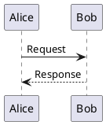

# 00 START HERE — PlantUML Server学習ガイド

## 1. 3分で理解する概要

このアプリは**文字列として記述した設計図を図形へ変換し、ブラウザでプレビューするツール**である。PlantUMLは独自の記法を持つテキスト言語で、一般の描画ツールと異なり「図形の座標を手動で配置する」作業を中心にしない。登場人物、関係、順序をテキストに記述すれば、PlantUMLエンジンがレイアウトする。

例：



この4行は、AliceからBobへの依頼とBobからAliceへの応答を表す。これをサーバーへ送り、レンダラで画像に変換する。フロントエンドは結果を`img`として表示する。

処理の流れ：

```text
ブラウザを開く
  ↓
PHPが一覧のHTMLを返す
  ↓
JavaScriptがJSONで例題リストを取得する
  ↓
例題を選択、UMLソースを編集する
  ↓
JavaScriptがPOSTでUMLソースを送信する
  ↓
PHP APIが検証する
  ↓
JARがある → Java/PlantUMLで描画
JARがない → PlantUML公式サーバーのURLを生成
  ↓
ブラウザが図を表示する
```

### 「サーバー」と「レンダラ」の違い

- **HTTPサーバー**はブラウザからの要求を受ける役。ここではPHP内蔵サーバーが担当。
- **レンダラ**はUMLのテキストを図に変換する役。実際の変換はPlantUMLエンジンが担当。
- **フロントエンド**はテキスト編集、ボタン操作、画像表示を担当。

PHP自身が`@startuml`の文法を解釈して図を作っているわけではない。これを区別できるとWeb開発の構造が見える。

## 2. 課題で特に重要なコード

| 重要度 | ファイル | 着目すること |
|---|---|---|
| 最重要 | `public/api.php` | HTTPリクエストを受け、JSONを読み、適切な返答を作る |
| 最重要 | `src/Renderer.php` | JARとJavaを呼び出す、入力を検証する、外部URLを作る |
| 最重要 | `public/assets/app.js` | fetchを使った非同期通信、画面の変更、イベント処理 |
| 重要 | `src/DiagramRepository.php` | JSONからデータを取り、検索とページ分割をする |
| 重要 | `public/index.php` | HTML画面と、PHPで埋め込むデータを分離する |
| 重要 | `src/PromptGenerator.php` | ルールベースの雛形生成とその限界 |
| 参考 | `public/assets/style.css` | グリッド・媒体幅・視覚デザイン |

## 3. 学習する技術の整理

**必須**：HTTP GET/POST、JSON、DOM、イベント、`fetch`、非同期処理、PHPのクラスと例外、出力のエスケープ。

**重要**：子プロセス、標準入出力、URLエンコーディング、Base64、ローカルストレージ、クライアント／サーバーの責務分離、CSP・XSSの基礎。

**参考**：PlantUML高度な文法、Graphviz内部、Monaco EditorのAMDモジュールローダー、Nginxの高度な設定。

## 4. 15分・30分・60分の読み方

**15分**：`01_ARCHITECTURE.md`の構成図を確認→`03_EXECUTION_FLOW.md`でAPI通信を追う→`public/api.php`でGET/POST分岐を見る。

**30分**：15分コース＋`Renderer.php`の`validateSource`/`localRender`と、`app.js`の`render`/`display`を読む。どのデータが何型で渡されるか説明できればよい。

**60分**：30分コース＋コードウォークスルー→`05_REVIEW.md`の問題を解く。自分でレンダリングAPIを1回呼ぶ。

## 5. 見なくてよい部分と先に見る部分

細かなCSSパラメータやPlantUMLのテーマ全種類を暗記する必要はない。まず「入力→HTTP→サーバー→描画→HTTP→表示」の流れを言葉で説明できることを優先する。次に、APIの入力検証と失敗時の動作を確認する。

## 6. 重要な制約

- ローカルJARが未導入のとき、公式PlantUMLサーバーへの画像URLを使う。通信先にソースが送られることを意識する。
- プロンプト補助はAIではない。文章のすべてを理解して正しい図に直すものではない。
- `tools/plantuml.jar`はZIPに含まれない。画像生成は実際のPlantUMLが必要。
- 公開時には認証・レート制限などが必要。開発サーバーのまま本番公開しない。

## 7. 分野別の知識の接続

ソフトウェア設計では、フロント・API・データ・外部処理の役割分担、インターフェース、例外処理を学べる。データ処理ではJSONとページネーション、非同期処理、データの変換過程を学べる。Web UIではエディタ・イベント・レスポンシブ表示・ブラウザストレージが重要になる。

**最初の学習目標**：エディタで「Alice -> Bob: Hi」と書いた後、どのファイルのどの関数が呼ばれてプレビューが変わるのかを、コードを見ずに概説できること。
