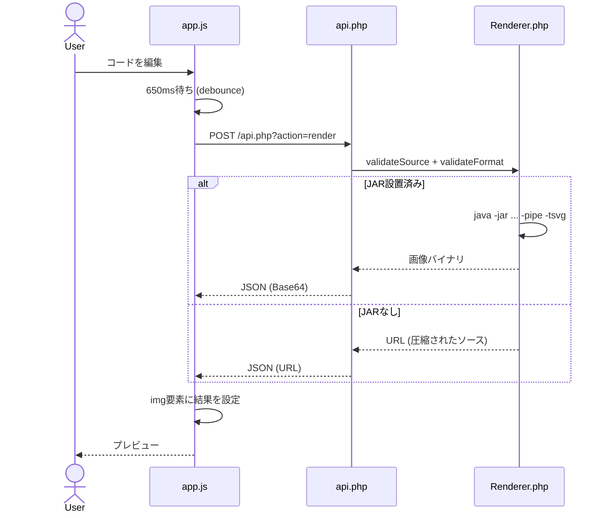

# 01 ARCHITECTURE — 設計とファイル依存関係

## 1. なぜこの構成か

このプロジェクトは、**公開してよいファイルを`public/`に限定する**ことを設計の最優先にしている。`src/`にアプリケーションロジック、`storage/`にサンプルデータを置く。Webサーバーは`public/`しか直接配信できないので、PHPクラスや例題JSONのディレクトリが直接公開されない。

```text
public/index.php ──(HTMLを表示)──> ブラウザ
        │                              │
        └── PHP bootstrap              └── app.js
                                          │ fetch(GET/POST)
                                          ↓
                                     public/api.php
                                      │       │
                         DiagramRepository  Renderer
                                      │       │
                              examples.json │
                                            ├─ Java + PlantUML JAR
                                            └─ 公式PlantUMLサーバー用URL
```

## 2. 各ファイルの責務

### `public/index.php`

ブラウザに最初に表示するHTMLを作る。URLに`?id=5`があれば例題の詳細画面を、なければ一覧画面を表示する。PHPはエスケープ済みのタイトルやテーマをHTMLへ埋め込むが、編集・画像更新などの動的な処理はJavaScriptへ委譲する。

### `public/api.php`

HTTPリクエストを受付け、`action`で処理を分岐する。例えば`GET action=list`は一覧JSON、`POST action=render`は画像情報を返す。不正なJSONは422、存在しないIDは404、実行時のエラーは500を返す。

### `src/DiagramRepository.php`

`storage/examples.json`を読み、`find`で個別データ、`paginate`で一覧データを返す。一覧では不要な`uml`や`prompt`を除外する。ページネーションは5件ずつ。これは表示に不要なデータを渡さず、APIの責務を明確にする例。

### `src/Renderer.php`

PlantUML描画を担当。外部ファイル読込などを排除する検証を行い、JARがあればJavaの子プロセスを実行し、その標準入出力でUMLと画像を交換する。なければUMLソースを公式サーバーのURL形式に圧縮エンコードする。

### `src/PromptGenerator.php`

演習文から限定的な雛形を作る。正解コードの生成ではなく、ヒント・骨格の提供。UML文法を知って自力で調整することが前提。

### `public/assets/app.js`

一覧の描画、ボタンのイベント、テキスト編集、API呼出、結果の表示、ダウンロードとlocalStorage保存をまとめる。DOM（ブラウザ内のHTML構造）とアプリケーション状態の橋渡しをする。

## 3. テキストの流れ



## 4. 「描画」処理の責務が分離される理由

もしUIのコード中にJavaの起動処理を書こうとすると、ブラウザには任意のプログラムをサーバー側で起動する権限がない。また、APIに検索・UI変更・描画・ファイル保存をすべて詰め込むと、テスト対象を切り出せなくなる。

そのためHTTPの受付は`api.php`、本体の変換は`Renderer`、画面操作は`app.js`に分ける。この分割によって、PHPのテストでは`Renderer`を直接呼び出して検証でき、HTTPテストではブラウザなしでAPIの動作を確認できる。

## 5. データ保管場所

| 情報 | 保管方法 | 保存期間 |
|---|---|---|
| サンプルのタイトル・課題文・正解UML | `storage/examples.json` | ファイルが残る限り |
| ユーザーが現在編集中のUML | ブラウザ`localStorage` | 同一オリジンのユーザーが削除するまで |
| 生成SVG/PNG/TXT | APIレスポンスのバイト列 | リクエスト処理中だけ |
| プロンプトからの雛形 | ブラウザのメモリ | ページを閉じるまで（エディタに反映したらlocalStorageにも保存） |

大量の一時画像をサーバーに保存しないので、「不要になったファイルの削除」を簡略化できる。ただし、大規模サービスならレンダリングキャッシュや利用数制限を検討する。

## 6. 依存関係と外部サービス

- PHP:必須。HTTP APIとHTMLを生成。
- Java+PlantUML JAR:ローカル画像生成時に必要。
- Graphviz:一部のUML図に必要。
- Monaco Editor CDN:任意。ロード失敗時はtextareaへ切替。
- 公式PlantUMLサーバー: JARなしの場合に利用。プライバシーへの影響に注意。

## 7. フェイルセーフ

ソースが大きい・不正→HTTP422。Java側の問題→HTTP500。JAR未導入のダウンロード→HTTP503。CDNが使えない→標準エディタへ切替。例題IDが見つからない→HTTP404。これらは「無条件に成功させる」より重要な信頼性の要素である。
