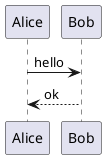

# 03 EXECUTION FLOW — 具体的な値を使った実行トレース

## 1. 一覧画面が表示されるまで

1. ユーザーが`http://localhost:8000/`へアクセスする。
2. `public/router.php`が`/`を`public/index.php`に委譲する。
3. `index.php`は`id`なしと判定し、`<tbody id="diagram-rows">`を含むHTMLを返す。
4. ブラウザが`app.js`を読み、`document.body.dataset.id`を確認する。空文字なので`library()`へ入る。
5. `fetch('/api.php?action=list&page=1&q=')`が実行される。
6. `api.php`の`list`分岐が`DiagramRepository::paginate(1,5,'')`を呼ぶ。
7. 全20件のJSONから先頭5件が選ばれ、`{items:[...],total:20,page:1,pages:4}`が返る。
8. `app.js`がDOMで5行を組み立てる。ユーザーが3ページ目をクリックすると`page=3`へ変わり、APIが11〜15件目を返す。

## 2. 編集とプレビューが起きるまで

例題ID=1の初期入力を次とする。

1. `?id=1`のHTMLから`data-id="1"`を取得。
2. JSが`GET /api.php?action=detail&id=1`を送信し、UML本文を含むJSONを取得。
3. `localStorage`に`plantuml-exercise-1`があればそちらを採用。なければJSONの`uml`をtextareaへ設定。
4. `GET /api.php?action=status`を送信。JARありなら`hasLocalEngine:true`、なければ`false`。
5. 初期プレビューで`render()`を呼ぶ。`currentFormat='svg'`、`currentRequest`が1増える。
6. `POST /api.php?action=render`に `{uml: 上のソース, format: 'svg'}` を送る。
7. PHPは`validateSource`で文字数・UTF-8・外部読み込み命令を検査する。
8. **JARあり**: `java -jar ... -pipe -tsvg`へstdinでコードを渡し、stdoutでSVGを受け、`base64_encode`してJSONへ入れる。
9. **JARなし**: 圧縮した文字列を`https://www.plantuml.com/plantuml/svg/<encoded>`のパスへ入れたURLを返す。
10. JSの`display`が`img`を生成して`src`に画像を渡す。
11. ユーザーが`Alice -> Bob: hello`を`Alice -> Bob: login`へ変更する。`onEdit`がlocalStorageへ反映し、650ms待った後に再描画。

### 「古いリクエスト」の扱い

通信Aを送った後で通信Bを送った場合、Bが先に返ることがある。`currentRequest`に番号を付けることで、Aが最後に返っても古い結果として捨てる。これがないと、入力が新しいのにプレビューが古い状態へ戻ることがある。

## 3. ダウンロード

### ローカルJARがある場合

1. 画面でSVGボタンを選択する。
2. ダウンロードボタンを押す。
3. `POST /api.php?action=download`とJSONを送る。
4. PHPが`Content-Type: image/svg+xml`、`Content-Disposition: attachment; filename="diagram.svg"`を指定し、ファイル内容を返す。
5. ブラウザ側で`response.blob()`として受け、`URL.createObjectURL()`で一時URLを作り、`a.download`から保存する。
6. `URL.revokeObjectURL()`で一時URLを破棄する。これはブラウザ内の一時リソースの解放であって、サーバー上のファイル削除ではない。

### JARがない場合

PHPは添付ファイルを生成できない。アプリは公式サーバーのURLを新しいタブで開く。ユーザーがブラウザで手動保存する。**これをファイルダウンロード成功とみなしてはいけない**。

## 4. 雛形生成

1. 演習文をテキストボックスに入力する。例：`Alice -> Bob: Hello`。
2. 「雛形を生成」をクリック。
3. `POST action=generate`を送信する。
4. `PromptGenerator::generate`が明示的な矢印構文を見つけたらそれを`@startuml`と`@enduml`で包んで返す。
5. JSが`generated-code`へ`textContent`で表示する。
6. 「生成案をエディタへ反映」でエディタ内容を更新する。

**重要**：日本語の一般的な説明文から複雑なUML構造を推論するわけではない。この機能は基本テンプレートを出すための学習補助。

## 5. 典型的な異常処理

- UMLが空文字 → PHPの`InvalidArgumentException` → HTTP422 → JSのcatchでエラーメッセージを表示。
- 存在しない図ID → APIはHTTP404、ページもHTTP404。
- JARがあるがJavaが失敗 → 例外 → HTTP500。サーバーログを確認する。
- CDNが使えない → Monaco読み込み失敗 → textareaエディタは利用可能。
- ローカルJARもネットもない → 編集は可能だがレンダリング不能。プライバシー状態は画面に表示。
